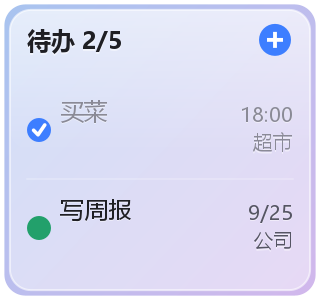
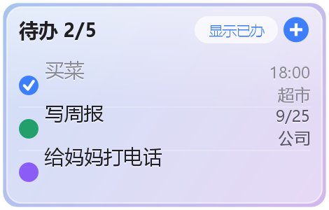
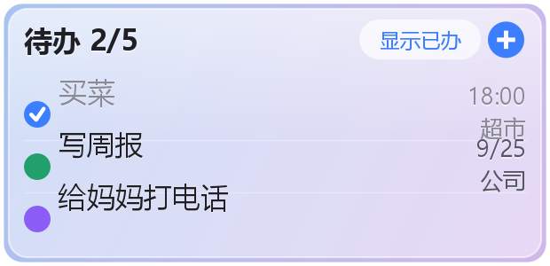

| 小组件的颜色圆点 | 每条待办前面是**它标记颜色的实心圆**（没设颜色是中性灰），完成了变成打勾图标 || 颜色标注 | 加待办时直接挑一个**标记颜色**（14 个备选，选色面板一行 6 个居中排列），列表、日历、小组件里都用这个颜色显示；**没设颜色的待办前面是透明细边框的空心圆** || 日历（周） | 课程表样式：格子拉高，每条待办是**浅色实心矩形 + 黑字**（两三个字），上下位置按它的时间摆放（最多 5 条），一屏正好一周，`‹ ›` 翻周 || 日历（月） | 整月 6 行，**那天有安排就整格填淡色**：只有一条且设了颜色就用它的淡色，没设颜色或有多条（多个颜色）就填淡灰；日期数字在格里上下左右居中 |# 干点啥（SimpleTodo）

[](LICENSE)


一个可以直接安装在安卓手机上用的待办清单应用，带桌面小组件：不用打开应用，在桌面上就能看清单、打勾、快速添加。纯 Android 框架 API 实现，无第三方依赖、零权限、不联网。

一个可以在安卓手机上直接用的待办清单应用，带**桌面小组件**：不用打开应用，在桌面上就能看清单、打勾、直接添加待办。

- **应用界面：不透明白底**（深色模式近黑），长时间看清单不累眼，不做穿透、不做模糊。
- **桌面小组件：透明玻璃**，可以在「透明毛玻璃 / 液态玻璃」两种外观之间切换，壁纸会透出来。
- 纯 Android 框架 API + Java 实现，**没有任何第三方依赖**（不需要 AndroidX、不需要 Kotlin、不需要联网、不需要登录），装上就能用。
- 数据只存在手机本地的 SQLite 数据库里（升级不丢数据）。
- 界面全中文，深色模式跟随系统。

### 小组件预览（三种尺寸）

| 2×2 | 3×2 | 4×2 |
| --- | --- | --- |
|  |  |  |

预览图是这两个脚本生成的：`tools/GenIcons.java`（画图标和预览图）、`tools/check_widget_layouts.sh`（校验小组件布局只用了系统支持的控件）。

## 功能

| 功能 | 说明 |
| --- | --- |
| 添加待办 | 输入内容点「＋」**直接添加（不设置时间）**，老习惯不用改 |
| 设置待办时间 | 想带时间就先把「下一条…」的时间选好（今天 / 明天 / 自定义日期时刻），再点「＋」 |
| 改时间 | 待办上的时间点一下就改，可以改成别的时间或「清除时间」 |
| 时间显示 | 今天 18:00 / 明天 09:00 / 9月25日 14:30；**过期未完成会标红**；有时间的待办自动排在前面 |
| 打勾完成 | 点方框或点整行文字都能切换完成状态，已完成显示为灰色带删除线 |
| 筛选 | 「全部 / 未完成 / 已完成」三个标签切换 |
| 视图切换 | 顶部「**列表 / 日历**」两种视图，日历上一个按钮在**月 / 周**之间切（按钮上写的就是要切过去的那一个字） |
| 日历（缩小） | 整月 6 行，每个有安排的日期用**对应颜色的浅色实心块**标出来（最多 4 个），点某天看那天的待办 |
| 日历（放大） | 课程表样式：格子拉高，里面能看到**两三个字 + 标记颜色**（最多 5 条），一屏正好一周，`‹ ›` 翻周 |
| 颜色标注 | 加待办时直接挑一个**标记颜色**（14 个备选），列表、日历、小组件里都用这个颜色显示 |
| 颜色胶囊 | 输入框下面点「颜色」挑色，还有「不设颜色」；事后点待办前面的彩色圆点也能改 |
| 一键重置 | 输入框右边、加号后面有个「重置」：一键清掉还没用到的时间、地点、颜色 |
| 设置 | **右上角设置按钮**里整合了三件事：桌面小组件显示（透明毛玻璃 / 液态玻璃）、**主题色**（蓝 / 绿 / 紫 / 橙 / 红 / 青）、**深浅模式**（跟随系统 / 浅色 / 深色） |
| 说明 | 设置里右上角**圆圈问号**：主要功能逐条说明 + 更新记录 |
| 首次打开声明 | 本机**第一次**打开弹一次：「本软件为AI制作，免费公开使用，如果您在其他平台付费获得，请尽快联系处理」，正文居中，底部「我知道了」关闭，之后不再弹 |
| 制作者签名 | 设置面板底部一行：**制作者：弌弍弎-AI**（不写进说明里） |
| 地点 | 待办可以填一个**地点**（自己填文本，不做定位）；新建时点「地点」胶囊 |
| 编辑待办 | 每行右侧（删除按钮左边）有个**铅笔按钮**，点它改**内容、时间、地点**；点时间/地点那一行也行，保存后小组件同步 |
| 拖拽排序 | **长按整行**直接上下拖拽调整顺序（有落点高亮、松手生效），只能在同一组（有日期/无日期/已完成）内挪动；只影响应用列表，小组件不变 |
| 有日期 / 无日期分开 | 列表、月视图、周视图、桌面小组件里都把**有日期**和**无日期**的待办分成两组显示 |
| 删除 | 每行右侧垃圾桶图标删除单条（有二次确认）；底部「清除已完成」批量清理 |
| 桌面小组件 | **三种尺寸：2×2 / 3×2 / 4×2**，每种在桌面「小组件」列表里是一个独立条目 |
| 小组件里勾选完成 | 点小组件里某一行（或前面的方框）＝**打勾完成**，再点一下＝取消完成 |
| 小组件的颜色圆点 | 每条待办前面是**它标记颜色的实心圆**（没设颜色是中性灰），完成了变成打勾图标 |
| 小组件分组 | 有日期的排前面；没有日期的单独一组（带「无日期」小标题），已完成也单独一组 |
| 小组件小字明细 | 每条待办右边两行小字：**上一行时间、下一行地点**（地点最多前 4 个字，多的用「…」） |
| 小组件只看当天 | 设了时间的待办**只在它所在的那一天**出现在小组件里，其它日期不显示（没设时间的始终显示） |
| 小组件里快速添加 | 右上角**圆圈加号 ⊕**：弹出小卡片，只填标题就能存（也可以顺手设时间），不用打开应用 |
| 小组件不删除 | 小组件里**没有删除按钮**，避免在桌面上误删；删除统一在应用里做（有确认） |
| 小组件外观 | 应用里「小组件外观」可在**透明毛玻璃 / 液态玻璃**之间切换，只影响小组件 |
| 文字自动适配壁纸 | 小组件文字颜色**跟着桌面壁纸明暗自动切黑字/白字**，深色壁纸上不会看不清 |
| 自动换布局 | 拖动小组件边缘改大小后，布局、字号、每行高度会自动切换 |
| 实时同步 | 数据一变化，桌面小组件立刻刷新（不靠定时轮询） |

**关于时间**：目前时间是「什么时候要做」的标记，到点了**不会弹通知、不会响铃**——所以这个应用不需要通知权限、不需要闹钟权限、也不需要任何其它权限。想要到点提醒的话告诉我，那需要额外申请通知权限。

## 直接安装使用（推荐）

安装方式二选一：

1. **自己编译**（最省事，一条命令）：见下面「自己编译」，产出 `app/build/outputs/apk/release/app-release.apk`，传到手机上点开安装即可。
2. **直接下载现成的**：如果本仓库的 Releases 页面附了 apk，直接下载安装；没有就按第 1 条自己编一个。

安装方式任选其一：

1. 把 apk 传到手机（微信/QQ/数据线均可），点开安装，提示「未知来源」时允许一次。
2. 用数据线连电脑，打开 USB 调试后执行：`adb install -r SimpleTodo/SimpleTodo-v1.4-debug.apk`

> **升级提示**：应用里的待办不会丢（数据库会自动迁移）。但小组件的实现改过几轮，**桌面上旧的小组件建议删掉重新拖一个**。
> 3.3 起交付的是 **release 包**（同样用调试证书签名，可以直接覆盖安装）：它的 `debuggable=false`，比 debug 包更不容易被挂调试器和注入；`adb install -r` 或直接点开安装都可以。
> 自己重新构建时：`gradlew assembleRelease` 出 release 包，`gradlew assembleDebug` 出 debug 包。
>
> 另外：功能性的实现细节（尺寸公式、白名单、模糊限制等）只写在这份 README 里，应用界面和小组件上不显示这些技术说明，只保留使用相关的文案。

## 小组件

### 三种尺寸

| 条目 | 占的格子 | minWidth × minHeight |
| --- | --- | --- |
| 干点啥 · 小 2×2 | 2 列 × 2 行 | **110 × 110 dp** |
| 干点啥 · 中 3×2 | 3 列 × 2 行 | **180 × 110 dp** |
| 干点啥 · 大 4×2 | 4 列 × 2 行 | **250 × 110 dp** |

同时写了 `targetCellWidth/Height`（Android 12+ 优先按格子数定位）和 `minWidth/minHeight`（老路径兜底）。

#### 尺寸数据为什么是这几组数字

之前的版本 2×2 写的是 130×117dp（按「宽度取竖屏格子 73n−16、高度取横屏格子 66m−15」算出来的），结果在荣耀桌面上**小组件比系统的 2×2 文件夹小组件高出一截**。原因是桌面还有一条老规矩：

```
占几格 = ceil((声明尺寸 + 30) / 70)
```

也就是说 2 格对应的精确值是 `70×2−30 = 110dp`，代入公式刚好 `(110+30)/70 = 2.0`；而 **117dp 会算成 2.1 → 向上取整成 3 格**，小组件就占了 3 行，比 2×2 的文件夹小组件长一段。同理 3 格必须写 180dp、4 格必须写 250dp，否则也会被顶到下一格。

所以现在三档统一用 `70 × 格数 − 30`：110 / 180 / 250，高度一律 110。这组值既能通过老公式整除（不被向上取整），又小于现代网格的实际可用尺寸（竖屏 2 列约 130dp、2 行约 220dp），两种算法下都落在正确的格子里。

#### 高度和布局的关系

桌面在竖屏下给 2 行的实际高度通常有 200dp 以上（远大于声明的 110dp），所以 2×2 的行高、方框、字号按「填得满高格子」来配：行高 34dp、方框 19dp、标题 13sp、内边距 12dp（对应荣耀 S 卡 12dp 安全边距）。

#### 2×2 比文件夹高一点点的问题（1.6 的处理）

把 minHeight 从 117 改成 110 之后，格子数就正确了（2 格）——判断依据是：如果还是 3 格，会高约 1/2；实测只高约 1/6，说明差的是**行高**而不是格子数：

- 桌面给「2 格高的小组件」留的行高，比给「2 行图标」（文件夹就是按图标行排的）留的行高更高，所以 2 格小组件的盒子天生就比 2 格文件夹高出一截。
- **盒子多大由桌面决定，小组件改不了**；但玻璃底画多大是我们说了算。所以 1.6 里 2×2 的玻璃底会**按桌面给的实际高度自动内缩 1/7**（8~40dp 之间），下边缘就和文件夹对齐了，上边缘不变。
- 相关常量在 `BaseTodoWidgetProvider.java`：`BOTTOM_INSET_DIVISOR`（默认 5.5，改成 1 就没有留白、改成 4 会缩得更多）、`BOTTOM_INSET_MIN_DP` / `BOTTOM_INSET_MAX_DP`（8~40dp）。
  - 这个系数是这么定的：1/7 时下边缘还比系统组件高一丁点，1/5 会缩过头，所以取中间的 1/5.5（约 18%）；按对照图估算，真实差值是 2~3% 上下。
- 另外 `widgetBox()` 会把这台机器给小组件的实际尺寸写进 logcat（`adb logcat -s SimpleTodo`），需要核对格子数时可以看到竖屏/横屏分别是多少 dp。

#### 文字颜色跟着壁纸明暗自动切（1.7）

透明毛玻璃下如果固定用黑字，深色壁纸上就看不清。1.7 改成自动判断：

- 用系统的 `WallpaperManager.getWallpaperColors(FLAG_SYSTEM)` 拿壁纸主色——**这个 API 不需要任何权限**，就是系统给桌面/状态栏判断该用深字还是浅字用的。
- Android 12+ 优先用它给的 `colorHints`（`HINT_SUPPORTS_DARK_TEXT` 即“这里适合深色文字”）；更低版本或系统没给 hints 时，算壁纸主色的亮度来兜底。
- 再把小组件玻璃底那层浅色叠加算进去（玻璃会把背景提亮，所以深色文字的适用范围比想象中大），等效亮度超过 0.55 就用黑字，否则用白字。
- 黑字/白字两套配色里，主文字、次要文字（时间）、已完成、过期红、胶囊强调色都是分别挑的，空心方框图标也会换成深色描边版本（`ic_check_off_dark.xml`），保证两种情况下都看得见。
- 换壁纸后会立刻重刷小组件：进程内注册一次 `addOnColorsChangedListener`（同样不需要权限），壁纸颜色一变就 `refreshAll()`。拿不到壁纸颜色（动态壁纸、颜色还没算好）时，回退成跟随系统深色模式。
- 相关实现都在 `WidgetPalette.java`：`DARK_TEXT_THRESHOLD` 控制灵敏度，`LIQUID_TINT_ALPHA` / `FROST_TINT_ALPHA` 是两种外观那层底的透明度。

### 怎么用

- **点某一行（或前面的方框）＝打勾完成**，再点一下＝取消完成；已完成会沉到底部并变灰（默认隐藏，点「显示已办」可看）；
- **点右上角的圆圈加号 ⊕ ＝ 快速添加**：输入内容点「保存」就行（不设置时间），想设时间点一下卡片里的「不设置时间」再选；
- 时间显示在每行右端，紧凑格式：`18:00`（今天）/ `明18:00`（明天）/ `9/25`（更远），过期标红；
- **点标题（"待办 2/5"）打开应用**；小组件里没有删除。
- **只有「今天」的待办会出现在小组件里**：设了时间的待办只在它所在的那一天显示，其它日期不显示（到那天自然会出现）；没有设时间的待办不在时间轴上，所以一直显示。这里比较的是**日期**，同一天几点都算。副作用：过期的待办不会留在小组件里——它们仍在应用里（标红）等你处理，不会丢。

### 小组件外观（只影响小组件）

应用右上角点「小组件外观」，对话框里是两个可选项（各带说明和选中标记），点哪个立刻生效：

| | 透明毛玻璃 | 液态玻璃 |
| --- | --- | --- |
| 小组件底的浓度 | 约 30% 不透明（深色模式 35%） | 约 40% 加上高光描边和顶部渐亮 |
| 适合 | 壁纸比较素、想尽量透 | 壁纸很花、想更清晰 |

两种外观的浓度都是对着系统组件调的（以荣耀的天气小组件为参照：约 30~40% 的底 + 1dp 浅色细描边）：1.8 把透明毛玻璃从 15% 提到了 30%，不再像以前那样淡得看不清边界。

> 改浓度时注意同步改两处：`values/colors.xml`（深色主题在 `values-night/colors.xml`）里的 `widget_frost_fill` / `widget_glass_fill`，以及 `WidgetPalette.java` 里的 `FROST_TINT_ALPHA` / `LIQUID_TINT_ALPHA`——后者参与「该用黑字还是白字」的计算，不同步会导致文字颜色判断偏差。

**桌面小组件无法「真模糊」壁纸**：小组件是桌面进程画出来的，Android 没给 `RemoteViews` 提供模糊背后内容的能力（第三方小组件都做不到，除非自己截图壁纸再模糊，那样更耗电且壁纸一动就失效）。所以小组件用的是半透明玻璃 + 文字阴影来保证可读。

**应用界面固定是不透明白底**（深色模式近黑），所以打开应用是整屏统一的干净白底，不会看到壁纸、也不会有半透明干扰。

## 视图与颜色标注

### 列表 / 日历

顶部的切换条只有两个：**列表** 和 **日历**。日历上有一个按钮在**月 / 周**之间切换（按钮文字就是点一下会切过去的那个：月视图时显示「周」，周视图时显示「月」），所以不需要单独占一个标签页：

- **月**：6 行日历。那天有安排就**把整格填成淡色**：只有一条待办且设了颜色 → 填它的淡色（约 24% 不透明）；没设颜色、或者有多条（或多个颜色）→ 填淡灰。日期数字在格子里上下左右居中，今天用强调色加粗，选中的那天再描一圈描边。用「格子背景」来做标记是因为背景是格子上本来就在正常渲染的东西（选中高亮就是它）。
  如果整月都没有「设了时间的待办」，日历下面会出现一行提示说明原因（不是坏了）。`‹ ›` 翻月，标题是「2026年9月」。
- **周（课程表样式）**：只剩一行，格子拉高到 152dp。每条待办是一个**浅色实心矩形**（它的标记颜色、约 42% 不透明）+ **黑色文字**（2~3 个字，再长用「…」截断），同一天里按时间从早到晚排列（最多 5 条）。
  **方块的位置大致对应时间段**：一天按 6:00~24:00 映射到格子的高度上，9:00 的事就靠上、20:00 的事就靠下；如果几个待办时间挨得太近（块会叠在一起），后面的会自动往下顺延一点，保证不互相压住。
  因为一屏正好一周，`‹ ›` 这时是翻周，标题显示「9月22日 - 9月28日」这样的范围。
- 两种状态下，下面都是**选中那一天的待办**，再往下是「无日期」那一组；今天用强调色加粗，选中的那天套一圈描边。
- 月 / 周的选择会记住（存在 `app` 共享偏好里的 `calendar_zoomed`），下次打开还是上次那个。

`列表` 视图里按「有日期 / 无日期 / 已完成」分组显示（只有一组时不出标题，省地方）。日历数据来自待办自己的时间（`due`），所以给待办设了时间就会出现在日历上。

**分组的实现细节**：桌面小组件那边用了一个额外的小技巧——`RemoteViewsFactory` 接口里**没有** `getItemViewType`（我用 javap 对着 android.jar 确认过），一个列表里混排「待办行」和「标题行」两种布局在条目复用时会错乱，所以小组件的分组标题是**内嵌在待办行布局里**、用可见性切换出来的（标题行会把下面的待办内容整块 GONE 掉，并塞一个空点击意图，防止复用残留导致误触）。应用里的列表是普通 ListView，就正常用两种 viewType。

### 颜色标注

- 颜色是**加待办时直接挑的**，没有「分类」这一层：输入框下面有个「颜色」胶囊，前面的圆点就是当前挑中的颜色，点它可以换（14 个备选），下面还有「不设颜色」。
- 选好颜色再点「＋」，这条待办就带上颜色了；以后想换：点它标题前面那个**彩色圆点**。
- 选色面板一行 6 个色块、居中排列（14 个色分 3 行）。
- 颜色出现在四个地方：应用列表的圆点、日历格子里的浅色实心块（放大后是待办块的底色）、小组件每行前面的实心圆、以及小组件预览图（`tools/GenIcons.java` 生成的）。
- 没设颜色的待办用中性灰显示。

### 设置（3.0）

右上角设置按钮打开，三块内容：

- **桌面小组件显示**：透明毛玻璃 / 液态玻璃，只影响小组件，应用界面固定不透明白底。
- **主题色**：蓝 / 绿 / 紫 / 橙 / 红 / 青。做法是给主题叠一层只改 `colorAccent` 的样式，界面里的强调色都引用 `?android:attr/colorAccent`（或按主题属性解析），所以换色后重建界面即可整屏生效；小组件上那些原本写死颜色的图标（＋、已完成的对勾）改成用当前主题色**在代码里画成位图**，因为 RemoteViews 没法动态改色。
- **深浅模式**：跟随系统 / 浅色 / 深色。通过 `attachBaseContext` 按设置改写 configuration 的 uiMode，因此 `values-night` 那套资源整体生效（两个 Activity 都做了）。
- 右上角的**圆圈问号**是说明：主要功能逐条 + 更新记录，写得比较简略，细节看这份 README。

### 基础防线（3.3，都不影响正常使用）

代码里加了一层很轻的自我保护，平时完全无感：

- **每次打开顺手检查两件事**（只在第一次提示，之后静默）：① 本应用**不应声明任何权限**——多出权限（广告/木马基本都要联网权限）就提示一次；② 签名是否还是构建时那一个——对不上说明包被重新打包过，提示一次并建议重新安装。检查本身写错/查不到就当没问题，不会打扰使用。
- **Manifest 层面**：`allowBackup=false` + `dataExtractionRules`（禁止备份与设备迁移，数据只留在本机）、`usesCleartextTraffic=false` + `networkSecurityConfig`（禁止明文流量，本身也没有联网权限）、除桌面入口外所有组件 `exported=false`。
- **交付的是 release 包**：`debuggable=false`（debug 包默认可以被调试器附着，release 包不行），仍然用调试证书签名，所以可以直接覆盖安装。
- 提示弹窗只弹一次（记录在 `app_guard` 偏好里），并且放在 MainActivity 和 QuickAddActivity 两个入口上——即使第一次是从小组件的 ＋ 进来，也会弹。

### 排序与拖拽

- 每条待办带一个 `sort_order`，列表按它排。
- **初始顺序**：有时间的按时间从早到晚；没时间的按添加顺序（新的在上面）。升级到 v6 时会自动写好这套初始值，你看到的样子不会有变化。
- **手动调整**：长按某一行 → 那一行会跟着手指浮动一下，当前落点那一行会套上强调色描边 → 松手就生效。
  - 两个坑：① 触摸监听要装在**每一行**上（行本身可点击，装 ListView 上收不到按下事件）；② 影子行**不能加进 Activity 的视图树**（会触发重新布局、列表重建子视图，手势当场被取消，表现是"高亮闪一下就没了"），所以影子行用 WindowManager 子窗口来画，Activity 布局完全不动；拖拽期间也不发 notifyDataSetChanged，落点高亮是直接改那一行子视图的背景。
  - 只能在**同一组内**挪动（分组标题挡着，跨组不允许），松手后这一组会重新编号保存；
  - 调过顺序之后，新加的有时间的待办会排在该组末尾，没时间的还是顶到最前面（刚加的马上能看到）；
- 待办的标题和时间/地点文字都关掉了字体额外内边距（includeFontPadding=false），在行里是真正的上下居中。
  - 这个顺序只影响**应用里的列表**；日历、周视图、小组件里今天的安排仍然按时间排，方便看时间轴。

### 数据与升级

数据库升到 **v6**：v4 把分类换成了待办自带的 `color` 列（升级时会把原来分类的颜色搬到 color 上再删分类表，颜色不丢）；v5 新增 `place` 列存地点；v6 新增 `sort_order` 列做手动排序（升级时按「有时间的按时间、没时间的新的在前」写好初始值，观感不变）。都是 `onUpgrade` 里自动迁移，老待办一条不丢。

## 自己编译

### 方式一：Android Studio

`Open` 选中 `SimpleTodo` 目录 → 同步（没有第三方依赖，很快）→ 运行到手机，或 `Build → Build APK(s)`。

### 方式二：命令行

需要 JDK 17+ 和 Android SDK（`platforms;android-34`、`build-tools;34.0.0`）。工程自带 Gradle Wrapper，不用单独装 Gradle。

```bash
cd SimpleTodo
echo "sdk.dir=/你的/Android/Sdk/路径" > local.properties   # Windows: sdk.dir=C\:\\Android\\Sdk
./gradlew assembleDebug                                   # Windows: gradlew.bat assembleDebug
```

> `gradle/wrapper/gradle-wrapper.properties` 里的下载地址是腾讯云镜像（Gradle 官方源在国内常常只有几 KB/s）。海外用户可换回 `https\://services.gradle.org/distributions/gradle-8.7-bin.zip`。

## 代码结构

```
SimpleTodo/
├── build.gradle / settings.gradle / gradle.properties   构建配置
└── app/src/main/
    ├── AndroidManifest.xml                              2 个 Activity、三个小组件 Receiver、Service
    ├── java/com/minimal/todo/
    │   ├── Todo.java                    一条待办（due 时间、color 标记颜色）
    │   ├── TodoTime.java                时间的格式化（完整/紧凑）与过期判断
    │   ├── TodoStore.java               SQLite 存储 + 版本迁移（v4 去掉分类表、加 color）
    │   ├── MainActivity.java            主界面：列表 / 日历（可放大）+ 时间/颜色/外观入口
    │   ├── TodoAdapter.java             列表适配器（分组标题 + 颜色圆点）
    │   ├── MonthGrid.java               日历网格（缩小时圆点 / 放大时课程表内容）
    │   ├── TodoColors.java             颜色：应用里画圆点、小组件里生成圆形位图
    │   ├── ColorPicker.java             选颜色（14 个备选 + 不设颜色）
    │   ├── PlaceInput.java              填写地点（纯文本，不做定位）
    │   ├── TodoEditDialog.java          编辑待办：内容 / 时间 / 地点
    │   ├── ListDragReorder.java         长按拖拽调整顺序（只用应用里）
    │   ├── Accent.java                  主题色（几个常用色 + 主题属性解析）
    │   ├── ThemePrefs.java              深浅模式（跟随系统 / 浅色 / 深色）
    │   ├── AppGuard.java                首次声明弹窗 + 基础完整性检查
    │   ├── DuePicker.java               时间选择（今天 / 明天 / 自定义 / 清除）
    │   ├── QuickAddActivity.java        小组件 ⊕ 弹出的快速添加窗口
    │   ├── GlassPrefs.java              小组件外观偏好（透明毛玻璃 / 液态玻璃）
    │   ├── WidgetPalette.java           小组件文字配色（跟着壁纸明暗自适应）
    │   ├── WidgetPrefs.java             小组件偏好（是否显示已办）
    │   ├── WidgetStyle.java             小组件按宽度分档（2×2 / 3×2 / 4×2）→ 对应布局
    │   ├── BaseTodoWidgetProvider.java  小组件全部逻辑：布局、玻璃背景、点击、内缩
    │   ├── TodoWidget2x2 / 3x2 / 4x2.java  三个尺寸入口（空类，只注册默认尺寸）
    │   └── TodoWidgetService.java       小组件列表数据：分组标题 + 颜色圆点 + 6 字截断
    └── res/
        ├── layout/activity_main.xml     主界面
        ├── layout/dialog_settings.xml   设置面板（小组件显示 / 主题色 / 深浅 + 说明 + 制作者签名）
        ├── layout/dialog_first_run.xml  首次打开的声明弹窗（正文居中 + 我知道了）
        ├── layout/dialog_edit_todo.xml / dialog_place.xml / dialog_color_picker.xml  三个编辑弹窗
        ├── layout/item_todo.xml         主界面一行
        ├── layout/activity_quick_add.xml 快速添加弹窗
        ├── layout/widget_todo_2x2 / 3x2 / 4x2.xml        三种尺寸小组件
        ├── layout/widget_todo_item{,_small,_large}.xml   三种尺寸的行布局
        ├── xml/widget_info_2x2 / 3x2 / 4x2.xml           尺寸、预览图声明
        ├── drawable/bg_card · bg_input · bg_pill · bg_dialog_card · tab_bg   应用界面（不透明）
        ├── drawable/widget_glass.xml · widget_glass_frost.xml                小组件玻璃底
        └── values*/                     颜色、字符串、主题（含深色模式）
```

## 几个实现要点

- **应用界面不透明白底**：主题不开 `windowIsTranslucent`，`windowBackground` / 状态栏 / 导航栏都用 `@color/bg`；Android 11+ 走边到边 + insets 内边距，系统栏区域跟内容同色，所以整屏是统一白底。
- **小组件切换玻璃外观**：每个布局里叠了两层背景（`widget_glass_liquid` / `widget_glass_frost`），用 `RemoteViews.setViewVisibility()` 切换——不用为两种外观各写一套布局，也不依赖 `setBackgroundResource` 被 RemoteViews 调用的能力（那个受方法注解限制，不可靠）。
- **小组件布局只能用白名单控件**（FrameLayout/LinearLayout/RelativeLayout/GridLayout + AnalogClock/Button/Chronometer/ImageButton/ImageView/ProgressBar/TextView/ViewFlipper/ListView/GridView/StackView/AdapterViewFlipper）。用了别的（比如纯 `<View>`）桌面就会显示一坨黑块 +「无法添加小组件」。`tools/check_widget_layouts.sh` 会自动校验这一条，1.3 修的就是这个问题（当时误用了 `<View>`）。
- **每个待办显示 6 个字**：`TodoWidgetService.MAX_CHARS = 6`，按字符（代码点）算，中文和 emoji 都算一个字。
- **尺寸分档**：`WidgetStyle.java` 按小组件实际宽度分档，`< 180dp` 用 2×2 布局、`< 255dp` 用 3×2、更宽用 4×2；拉伸后会通过 `onAppWidgetOptionsChanged` 重新选布局。
- **时间排序**：`(due = 0) ASC, due ASC, id DESC` —— 设了时间的按时间从早到晚，没设时间的按添加顺序（新→旧）在后面；已完成那栏按添加顺序倒序。
- **小组件单击某行为什么知道点的是哪条**：模板 PendingIntent + 每行填充 Intent，每行带上自己的待办 id。模板必须用 `FLAG_MUTABLE`，否则 Android 12+ 上点方框没反应。

## 常见问题

- **小组件是一坨黑块、提示「无法添加小组件」？** 这是 RemoteViews 加载失败。排查：① 布局里用了白名单外的控件；② 用了 `android:onClick`；③ 布局里引用 `?attr/...` 主题属性；④ 对不存在的 id 调 `setViewVisibility` 之类。先跑 `tools/check_widget_layouts.sh`。本项目自己的这个问题在 1.3 已修。
- **桌面上找不到小组件？** 先确认应用装好并至少打开过一次；然后在小组件列表里往下翻，部分手机需要在「小组件」里切到全部应用列表。
- **小组件的高度/大小和我想要的不一样？** 格子数由桌面按声明的尺寸决定（本项目已按 `70×格数−30` 的整除值声明，2×2 就是 110dp）。如果 2×2 的**下边缘**比系统文件夹小组件高一点，那是桌面给小组件留的行高比图标行高大，1.7 已用「玻璃底按实际高度内缩 1/6」补偿；想再紧一点或去掉这条留白，改 `BOTTOM_INSET_DIVISOR` 即可。
- **深色壁纸上小组件字看不清？** 1.7 起文字颜色会跟着壁纸明暗自动切（黑字/白字）。如果判断得不对（比如深色壁纸仍显示黑字），说明这台机器的壁纸颜色接口没给结果、回退到了系统深色模式——把系统切成深色模式即可；也可以调 `WidgetPalette.DARK_TEXT_THRESHOLD` 让它更容易判成“深色壁纸”。
- **看不到「模糊的壁纸」？** 应用界面现在是纯白底，本来就看不到壁纸；小组件是半透明玻璃但**无法真模糊**（见上文）。想更透就把小组件外观切换成「透明毛玻璃」。
- **时间到点没提醒？** 设计如此：时间是标记，不做通知，所以不需要任何权限。
- **应用需要什么权限？** 一个都不需要（没有网络、存储、通知、闹钟权限）。

## 参考的开源实现

- Tasks.org（原 OpenTasks）—— 列表 + 完成状态筛选的交互
- jtxBoard —— 本地 SQLite 存储结构
- Android 官方 AppWidget 示例（`RemoteViewsService` + 模板 PendingIntent 的 collection widget 写法）与官方小组件尺寸换算公式

本项目为独立实现，未包含上述项目的代码。

## 许可证

MIT License，详见 [LICENSE](LICENSE)。

作者：**弌弍弎-AI**。本项目为独立实现，可自由使用、修改、再发布（保留版权声明即可）。
如果这个应用对你有用，欢迎点个 Star；如果你是在其他平台付费获得的，说明不是从我这里发布的，建议尽快联系处理。
